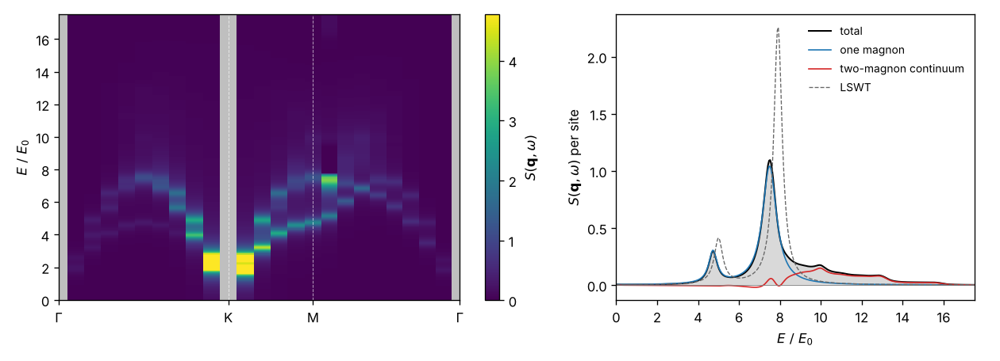

# 6. Interacting spin waves: 1/S energies, decays and S(q, ω)

Script: [`code-space/examples/tutorials/t06_interacting.py`](../../code-space/examples/tutorials/t06_interacting.py)

Linear spin-wave theory keeps the boson Hamiltonian to quadratic order. In a
noncollinear state such as the 120° state of the triangular-lattice
Heisenberg antiferromagnet, the next terms are cubic, and a magnon can decay
into two. This tutorial computes the next order in 1/S with `solve_nlswt`.
It covers three steps: the ground-state energy through order S⁰, the
shifted magnon energies and their decay rates, and the dynamical structure
factor through order S⁰.

## Ground-state energy through order S⁰

```python
import spintoolkit as stk
from spintoolkit.models import state_120, triangular_heisenberg

model = triangular_heisenberg(J=1.0, S=0.5)
result = stk.solve_nlswt(model, state_120(model), settings=stk.NLSWTSettings(mesh=(24, 24)))
result.energies.total
```

```
S = 0.5: E_cl = -0.375000  E_zp = -0.163808  E_(S^0) = -0.008012  total = -0.546820
```

The three terms are of order S², S and S⁰. The S⁰ term is the Hartree–Fock
energy of the quartic terms plus second-order perturbation theory in the
cubic ones, and it does not depend on S. Its converged value, −0.0080125 J,
is the result of the formulas of Chernyshev and Zhitomirsky (PRB 79, 144416
(2009)) evaluated independently. Their quoted coefficient differs in the
fifth digit, as explained in the theory note *LSWT nonlinear spin waves*
(check 4).

## Magnon energies and decay rates

```python
result.magnon_energies(k)          # LSWT, Hartree-Fock + tadpole, cubic, total
result.decay_rates(k, grid=(96, 96))
```

```
magnons at k = [2.0944 0.    ] (S = 1/2):
LSWT      [1.5811 1.5811 1.    ]
1/S       [1.0885 1.0885 0.7313]
decay     [0.1597 0.1597 0.    ]
```

The magnetic cell has three sites, so there are three bands. At S = 1/2 the
1/S correction lowers the upper two by about 30%, and these two decay into
the two-magnon continuum with half width Γ = 0.16 J. The lowest band lies
below the continuum, and its rate is exactly zero. `decay_rates` integrates
the golden rule over triangles of the zone, so it needs no broadening, and a
magnon below the continuum gets exactly zero rather than a small number.
Corrections this large mean that S = 1/2 is at the edge of what a 1/S
expansion controls. The strong downward renormalization and the decays
agree qualitatively with Chernyshev and Zhitomirsky.

## Dynamical structure factor through order S⁰

At order S⁰ the structure factor gains four things compared with LSWT:

- the decay broadening and energy shift of the one-magnon lines;
- the 1/S corrections of their weights;
- the two-magnon continuum;
- the interference between one- and two-magnon states that the cubic vertex
  mixes.

`interacting_path` computes all of them along a path. This example uses
S = 5/2, where the corrections are small enough to be controlled:

```python
from spintoolkit.observables import interacting_path
from spintoolkit.visualization import plot_intensity_path, plot_spectrum_cut

path = interacting_path(result, omega, eta=0.25, path=("Γ", "K", "M", "Γ"),
                        points=24, grid=(36, 36))
plot_intensity_path(path)
plot_spectrum_cut(path, i)
```



```
undefined path points (Goldstone modes): 3
path points where the expansion is not controlled: [16]
q = [2.094 0.   ]: total 2.061  one magnon 1.530  continuum 0.531  (LSWT 2.052)
```

The grey columns at Γ and K are Goldstone modes. The order-S⁰ spectrum is not
defined there, so it is reported as NaN rather than given a value. In the cut
halfway from Γ to K, the sharp LSWT lines (dashed) move down and broaden. The
weight they lose reappears in the two-magnon continuum above them (red),
while the integrated total stays close to the LSWT value.

`negative_weight` is the fraction of the computed spectrum that is negative.
It is zero where the expansion is controlled. Point 16 lies on M–Γ, where a
magnon branch touches the lower edge of the two-magnon continuum. There the
cubic self-energy is singular for any S, and the strict order-S⁰ result has
spikes of both signs. Treat the spectrum near such points, and near strongly
decaying magnons at small S, as not determined by this order.

For a decaying magnon the split between line and continuum within a few
line widths is a convention; only the total is fixed at this order. The
theory note *LSWT nonlinear spin waves* and decision record D59 give the
details.
