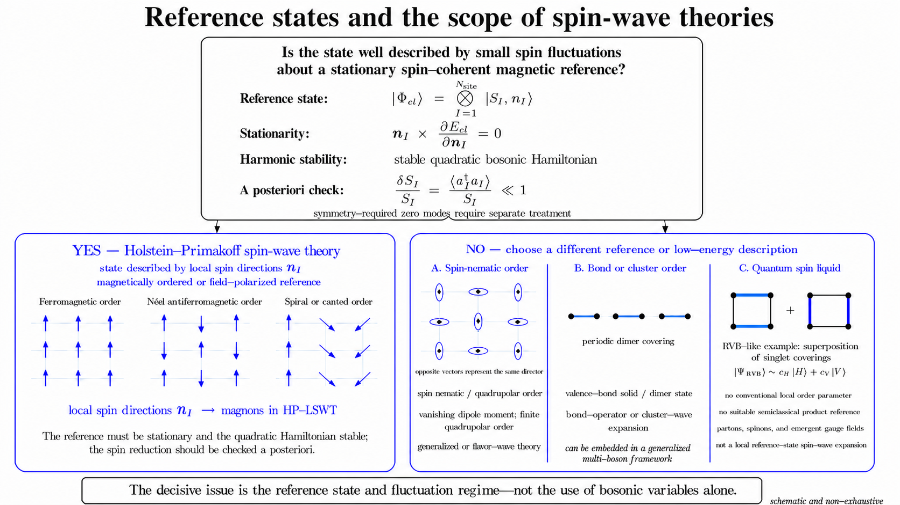

<!-- Converted from LaTeX on 2026-10-11. The LaTeX original is kept in docs/archive/2026-10-11-lswt-latex-notes/lswt-spin-hamiltonian/. Equation numbers are fixed in this form; the original \label of each numbered equation is in the comment before it. -->

<!-- Spin-Wave Theory Overview Converted on 2026-10-08 from docs/archive/2026-10-08-lswt-markdown/00-foundations/lswt-overview.md (status: draft, source-section: "Introduction to Spin Wave Theory: model and workflow"). Review status: draft; awaiting the user's physics and mathematics review. -->

# Spin-Wave Theory Overview

Spin-wave theory (SWT) describes low-energy collective spin excitations and the associated quantum fluctuations about an ordered reference state. The nature of that reference state determines the appropriate formulation: local spin directions describe magnetically ordered or field-polarized states, whereas multipolar and bond-ordered phases require enlarged local or cluster reference states. Phases without a suitable semiclassical product reference require a different low-energy description.

For states described by local spin directions, SWT is most commonly formulated using SU(2) spin-coherent states and Holstein–Primakoff bosons. Linear spin-wave theory (LSWT) is the harmonic approximation obtained by retaining terms up to quadratic order in these bosons.

*The classification is schematic and non-exhaustive. A compatible stationary reference and a stable quadratic Hamiltonian are prerequisites for Holstein–Primakoff LSWT, whereas a small spin reduction is an a posteriori check of the harmonic approximation.*

## Holstein–Primakoff Spin-Wave Theory

For spin length $S_I$ and a local unit vector $\mathbf n_I$, the reference configuration is represented by the spin-coherent product state

$$
|\Phi_{\mathrm{cl}}[\{\mathbf n_I\}]\rangle
=
\bigotimes_I |S_I,\mathbf n_I\rangle,
\qquad
\langle\Phi_{\mathrm{cl}}|
\hat{\mathbf S}_I
|\Phi_{\mathrm{cl}}\rangle
=
S_I\mathbf n_I.
$$

The classical energy associated with this reference state is

$$
E_{\mathrm{cl}}[\{\mathbf n_I\}]
=
\langle\Phi_{\mathrm{cl}}[\{\mathbf n_I\}]|
\hat H
|\Phi_{\mathrm{cl}}[\{\mathbf n_I\}]\rangle.
$$

The product state is the semiclassical expansion point, not an assertion that the exact quantum state is unentangled or has an ordered moment of magnitude $S_I$. The Holstein–Primakoff representation maps deviations from the local directions $\mathbf n_I$ to bosons, and the quadratic Hamiltonian describes their collective normal modes as magnons. The local-frame construction and bosonic expansion are developed in Classical Order and Local Frame in research note *LSWT classical order* and Holstein–Primakoff Expansion in research note *LSWT boson Hamiltonian*.

## Validity of Holstein–Primakoff LSWT

The existence of a spin-coherent reference configuration permits a Holstein–Primakoff representation to be constructed, but it does not by itself establish that LSWT is an appropriate approximation. Its prerequisites and self-consistency check have different logical roles:

- **Reference compatibility:** the state of interest must admit a low-energy description in terms of fluctuations about a local spin-coherent configuration.

- **Stationarity:** the reference configuration must satisfy $\mathbf n_I\times\partial E_{\mathrm{cl}}/\partial\mathbf n_I=0$, so that no term linear in the fluctuation bosons remains.

- **Harmonic stability:** the quadratic expansion must define a stable bosonic problem. The precise energetic and dynamical stability conditions, including the treatment of symmetry-required zero modes, belong to Paraunitary Diagonalization in research note *LSWT paraunitary diagonalization*.

- **A posteriori self-consistency:** after diagonalization, the local spin reduction $\delta S_I=\langle\hat a_I^\dagger\hat a_I\rangle$ should satisfy $\delta S_I/S_I\ll1$ wherever the harmonic approximation is used.

Failure of a prerequisite invalidates Holstein–Primakoff LSWT about the selected reference, whereas a large spin reduction signals that neglected interaction terms may be important. Neither conclusion rules out every possible spin-wave description. The momentum-space derivation developed here also assumes a commensurate reference configuration with a finite magnetic unit cell; this is a restriction of that derivation rather than a general limitation of SWT.

In two dimensions, the finite-temperature interpretation requires an additional qualification. A short-range isotropic Heisenberg model cannot sustain spontaneous ferromagnetic or antiferromagnetic long-range order at nonzero temperature. Consequently, a thermodynamic ordered-state interpretation of finite-temperature LSWT requires a symmetry-breaking field, anisotropy that removes the relevant continuous spin-rotation symmetry, interlayer coupling, a finite-size or crossover scale, or another physical infrared cutoff.

## Reference States Beyond Local Magnetic Order

States without a local magnetic direction require a different reference state. Spin-nematic states with quadrupolar order but no magnetic dipole moment provide a representative example. Flavor-wave theory enlarges the local state space and can describe quadrupolar or higher multipolar order. Bond-operator and cluster-wave theories instead expand about singlet dimers or larger local units. These approaches may retain a harmonic bosonic structure, but their fluctuation variables are not Holstein–Primakoff bosons about local spin directions. Multipolar moments can also coexist with magnetic dipole order, so the absence of a local spin direction is not a defining property of all multipolar phases.

A quantum spin liquid has no suitable semiclassical product reference for a local spin-wave expansion. Its low-energy description may instead involve fractionalized spinons and emergent gauge fields. The use of bosonic variables alone therefore does not determine whether a formulation is a spin-wave theory; the reference state and fluctuation expansion must also be specified.

## Bilinear Spin Hamiltonians

The Hamiltonian considered in the subsequent derivation is at most bilinear in the spin operators and can be written as

$$
\hat H
=
\sum_{\ell=(I,J)\in\mathcal L}
\hat{\mathbf S}_I
\mathbin{\cdot}
\mathsf J_\ell
\mathbin{\cdot}
\hat{\mathbf S}_J
+
\sum_I
\hat{\mathbf S}_I
\mathbin{\cdot}
\mathsf D_I
\mathbin{\cdot}
\hat{\mathbf S}_I
-
\sum_I
\mathbf h_I
\mathbin{\cdot}
\hat{\mathbf S}_I.
$$

The inter-site matrix $\mathsf J_\ell$ includes isotropic Heisenberg exchange, antisymmetric Dzyaloshinskii–Moriya interaction, and symmetric anisotropic exchange, including bond-dependent Kitaev-type couplings. The on-site matrix $\mathsf D_I$ represents single-ion anisotropy, and $\mathbf h_I$ is the Zeeman-energy coefficient determined by the applied field and the material-dependent $g$-tensor. Link orientation, counting conventions, and the relation between $\mathbf h_I$, the applied field, and the $g$-tensor are defined in Bilinear Spin Hamiltonian (Section *Bilinear Spin Hamiltonian*).

Genuine higher-order interactions, such as inter-site biquadratic coupling and four-spin ring exchange, lie outside this bilinear Hamiltonian class. Spin-wave expansions can be constructed for such models, but the resulting harmonic coefficients must be derived from those interactions rather than inferred from the bilinear formulas above.

## References

### Internal Documents

- Notation and Conventions (Section *Notation and Conventions*): defines the symbols, indices, geometry, and matrix typography used here.

- Bilinear Spin Hamiltonian (Section *Bilinear Spin Hamiltonian*): defines the Hamiltonian support and link-counting convention.

- Classical Order and Local Frame in research note *LSWT classical order*: defines the reference configuration and local-frame convention.

- Holstein–Primakoff Expansion in research note *LSWT boson Hamiltonian*: defines the bosonic representation and harmonic truncation.

- Real-Space Boson Hamiltonian in research note *LSWT boson Hamiltonian*: derives the quadratic Hamiltonian in real space.

- Momentum-Space BdG Hamiltonian in research note *LSWT boson Hamiltonian*: defines the Fourier and Nambu conventions.

- Paraunitary Diagonalization in research note *LSWT paraunitary diagonalization*: states the stability conditions and obtains the magnon modes.

### External Sources

- T. Holstein and H. Primakoff, [*Field Dependence of the Intrinsic Domain Magnetization of a Ferromagnet*](https://doi.org/10.1103/PhysRev.58.1098), *Physical Review* **58**, 1098–1113 (1940), DOI: `10.1103/PhysRev.58.1098`: introduces the Holstein–Primakoff boson representation.

- S. Toth and B. Lake, [*Linear spin wave theory for single-$Q$ incommensurate magnetic structures*](https://doi.org/10.1088/0953-8984/27/16/166002), *Journal of Physics: Condensed Matter* **27**, 166002 (2015), DOI: `10.1088/0953-8984/27/16/166002`: formulates LSWT using local spin frames and discusses its small-fluctuation regime.

- R. A. Muniz, Y. Kato, and C. D. Batista, [*Generalized spin-wave theory: application to the bilinear-biquadratic model*](https://doi.org/10.1093/ptep/ptu109), *Progress of Theoretical and Experimental Physics* **2014**, 083I01 (2014), DOI: `10.1093/ptep/ptu109`: distinguishes the SU(2) spin-coherent formulation from generalized spin-wave theories for multipolar states.

- L. Balents, [*Spin liquids in frustrated magnets*](https://doi.org/10.1038/nature08917), *Nature* **464**, 199–208 (2010), DOI: `10.1038/nature08917`: reviews quantum spin liquids, fractionalized excitations, and emergent gauge fields.

- S. Sachdev and R. N. Bhatt, [*Bond-operator representation of quantum spins: Mean-field theory of frustrated quantum Heisenberg antiferromagnets*](https://doi.org/10.1103/PhysRevB.41.9323), *Physical Review B* **41**, 9323–9329 (1990), DOI: `10.1103/PhysRevB.41.9323`: introduces the singlet–triplet bond-operator expansion used for dimerized quantum magnets.

- K. Majumdar, D. Furton, and G. S. Uhrig, [*Effects of ring exchange interaction on the Néel phase of two-dimensional, spatially anisotropic, frustrated Heisenberg quantum antiferromagnet*](https://doi.org/10.1103/PhysRevB.85.144420), *Physical Review B* **85**, 144420 (2012), DOI: `10.1103/PhysRevB.85.144420`: provides a spin-wave treatment of a Hamiltonian containing four-spin ring exchange.

- N. D. Mermin and H. Wagner, [*Absence of Ferromagnetism or Antiferromagnetism in One- or Two-Dimensional Isotropic Heisenberg Models*](https://doi.org/10.1103/PhysRevLett.17.1133), *Physical Review Letters* **17**, 1133–1136 (1966), DOI: `10.1103/PhysRevLett.17.1133`: establishes the absence of spontaneous ferro- or antiferromagnetic long-range order at nonzero temperature in the short-range isotropic one- and two-dimensional Heisenberg model.

<!-- Notation and Conventions Converted on 2026-10-08 from docs/archive/2026-10-08-lswt-markdown/00-foundations/notation-and-conventions.md (status: in-review, source-section: Summary of Notation and Symbols). Review status: in-review; awaiting the user's physics and mathematics review. -->

# Notation and Conventions

The notation below distinguishes spin sites, magnetic unit cells, interaction matrices, and bosonic operators throughout the LSWT derivation. Each symbol has a fixed meaning within its stated domain. Physical definitions and derivations are developed in the linked notes; the source-to-current notation correspondence is listed under [Legacy Source Mapping](#legacy-source-mapping).

## Typography

| Object | Form | Examples |
|:---|:---|:---|
| Scalar | Italic | $S_I$, $E_{\mathrm{cl}}$, $\varepsilon_{n\mathbf{k}}$ |
| Vector | Bold | $\mathbf{r}_I$, $\mathbf{k}$, $\hat{\mathbf{S}}_I$ |
| Latin-letter matrix | Sans serif | $\mathsf{J}_{\ell}$, $\mathsf{D}_I$, $\mathsf{R}_I$, $\mathsf{H}_{\mathbf{k}}$ |
| Quantum operator | Hat | $\hat H$, $\hat a_{i\mu}$, $\hat\Psi_{\mathbf{k}}$ |
| Set | Calligraphic | $\mathcal{L}$ |
| Identity matrix | Sans serif | $\mathsf{I}_N$ |

Hats denote quantum operators. Classical spin vectors and unit directions are written without hats, as $\mathbf S_I$ and $\mathbf n_I$. The Hamiltonian operator $\hat H$ is therefore distinct from its quadratic coefficient matrix $\mathsf H_{\mathbf k}$.

Conventional Greek matrix symbols, such as $\Sigma_3$, are exceptions to the sans-serif rule for Latin letters. Their dimensions and roles are stated where they are introduced. Transposition, complex conjugation, and Hermitian conjugation are denoted by superscripts $\mathsf T$, $*$, and $\dagger$, respectively. Exponentials are written as $\exp(\cdots)$, and the imaginary unit is $\mathrm i$.

A base letter may be shared by different object classes when typography makes the distinction explicit. Examples include the temperature $T$ and transformation matrix $\mathsf T_{\mathbf k}$, or the Dzyaloshinskii–Moriya vector $\mathbf D_\ell$ and on-site anisotropy matrix $\mathsf D_I$. The same matrix symbol is not assigned two different meanings.

## Indices and System Size

| Index | Meaning | Domain |
|:---|:---|:---|
| $i,j$ | Magnetic unit-cell index | Real space |
| $\mu,\nu$ | Magnetic sublattice index | One magnetic unit cell |
| $I,J$ | Physical spin-site index | $I=(i,\mu)$, $J=(j,\nu)$ |
| $\ell$ | Representative physical link | $\ell=(I,J)\in\mathcal L$ |
| $\alpha,\beta,\gamma$ | Laboratory-frame Cartesian component | $x,y,z$ |
| $n,m$ | Positive-energy magnon-band index | Momentum space |

The indices $n,m$ are reserved for magnon bands, so a sublattice index $\mu$ remains distinct from a band index $n$. Local circular components are labeled $+,-,0$; these labels do not replace the Cartesian meanings of $\alpha,\beta,\gamma$. The local basis is defined in Classical Order and Local Frame in research note *LSWT classical order*.

The inverse temperature is

$$
\beta\equiv(k_{\mathrm B}T)^{-1}.
$$

When a Cartesian index $\beta$ also appears in the same expression or immediately adjacent discussion, the inverse temperature is written as $\beta_T$. This exception distinguishes an index from a scalar without reassigning $i,j$ as Cartesian indices. The thermodynamic entropy is denoted by $\mathcal S$ to distinguish it from the spin length $S_I$; its definition belongs to Thermodynamics in research note *LSWT magnon thermodynamics*.

System sizes are denoted by

| Symbol              | Meaning                                               |
|:--------------------|:------------------------------------------------------|
| $N_{\mathrm{uc}}$   | Number of magnetic unit cells                         |
| $N_{\mathrm{sub}}$  | Number of magnetic sublattices per magnetic unit cell |
| $N_{\mathrm{site}}$ | Total number of physical spin sites                   |
| $N_k$               | Number of discrete momentum points                    |

so that

$$
N_{\mathrm{site}}
=N_{\mathrm{uc}}N_{\mathrm{sub}},
\qquad
\dim\mathsf H_{\mathbf k}=2N_{\mathrm{sub}}.
$$

The source symbols $L$, $N$, and $m_s$ are replaced by these quantities because their meanings vary across the source sections.

## Sites and Geometry

The basis position of sublattice $\mu$ within a magnetic unit cell is $\boldsymbol\delta_\mu$. A physical site and its position are written as

$$
I=(i,\mu),
\qquad
\mathbf r_I=\mathbf R_i+\boldsymbol\delta_\mu,
$$

where $\mathbf R_i$ is a magnetic Bravais-lattice vector. Equal classical spin angles alone do not identify two sites as the same magnetic sublattice; the magnetic translation pattern and local environment also enter the sublattice assignment.

For a two-dimensional lattice, the primitive vectors $\mathbf a_1,\mathbf a_2$ and reciprocal vectors $\mathbf b_1,\mathbf b_2$ satisfy

$$
\mathbf a_r\cdot\mathbf b_s=2\pi\delta_{rs},
\qquad r,s\in\{1,2\}.
$$

Real-space vectors share one Cartesian coordinate system, and momenta are expressed in the corresponding reciprocal Cartesian coordinates.

## Links and Bond Orientation

The set $\mathcal L$ contains each physical inter-site bond once. The representative orientation $\ell=(I,J)$ fixes the bond displacement and the ordering of the exchange matrix. The reverse orientation $\bar\ell=(J,I)$ is not separately included in $\mathcal L$.

The displacement from the first endpoint to the second is

$$
\boldsymbol\Delta_\ell
=\mathbf r_J-\mathbf r_I
=(\mathbf R_j-\mathbf R_i)
 +(\boldsymbol\delta_\nu-\boldsymbol\delta_\mu),
\qquad
\ell=((i,\mu),(j,\nu)).
$$

The laboratory-frame exchange matrix is $\mathsf J_\ell$, with Cartesian components $J_\ell^{\alpha\beta}$. Reversing the bond orientation gives

$$
\mathsf J_{\bar\ell}=\mathsf J_\ell^{\mathsf T},
\qquad
J_{JI}^{\beta\alpha}=J_{IJ}^{\alpha\beta}.
$$

This relation uses the real Cartesian exchange matrices of the bilinear model. Its expression in a complex circular basis depends on the component convention, which is not fixed here. The relation between the link sum and an ordered-pair sum, together with the separate treatment of on-site interactions, is given in Bilinear Spin Hamiltonian (Section *Bilinear Spin Hamiltonian*).

## Spins and Local Frames

| Symbol | Meaning |
|:---|:---|
| $S_I$ | Spin length at site $I$ |
| $\mathbf n_I$ | Classical spin unit direction |
| $\mathbf S_I=S_I\mathbf n_I$ | Classical spin vector |
| $\hat{\mathbf S}_I$ | Laboratory-frame quantum spin operator |
| $\hat{\widetilde{\mathbf S}}_I$ | Local-frame quantum spin operator |
| $\mathsf R_I$ | Rotation from local components to laboratory components |

We use the rotation convention

$$
\hat{\mathbf S}_I
=\mathsf R_I\hat{\widetilde{\mathbf S}}_I,
\qquad
\mathsf R_I^{\mathsf T}\mathsf R_I=\mathsf I_3.
$$

The columns of $\mathsf R_I$ are the local basis vectors expressed in laboratory coordinates. The exchange matrix in the local frames is

$$
\widetilde{\mathsf J}_{IJ}
=\mathsf R_I^{\mathsf T}\mathsf J_{IJ}\mathsf R_J.
$$

The polar angle $\theta_I$ is measured from the positive $z$ axis, and the azimuthal angle $\phi_I$ from the positive $x$ axis. For a general configuration, $\mathsf R_I=\mathsf R_{i\mu}$ depends on the site. For periodic order with magnetic translation symmetry,

$$
\mathsf R_{i\mu}=\mathsf R_\mu.
$$

Accordingly, real-space expressions use $\mathsf R_I$, while the momentum-space derivation uses the sublattice rotation $\mathsf R_\mu$.

## Boson and Magnon Operators

A Fourier transform changes the representation of a boson operator without changing its name. The symbol changes from $a$ to $b$ only when a Bogoliubov transformation replaces the sublattice basis by the magnon-band basis:

$$
\hat a_{i\mu}
\;\xrightarrow{\text{Fourier}}\;
\hat a_{\mathbf k\mu}
\;\xrightarrow{\text{Bogoliubov}}\;
\hat b_{\mathbf k n}.
$$

| Symbol | Meaning |
|:---|:---|
| $\hat a_{i\mu}$ | Real-space Holstein–Primakoff boson |
| $\hat a_{\mathbf k\mu}$ | Momentum-space representation of the same boson |
| $\hat b_{\mathbf k n}$ | Positive-energy magnon annihilation operator |
| $\hat n_{i\mu}=\hat a_{i\mu}^\dagger\hat a_{i\mu}$ | Local Holstein–Primakoff boson-number operator |
| $n_{\mathrm B}(\varepsilon)$ | Bose–Einstein distribution function |

The Nambu spinors before and after diagonalization are

$$
\hat\Psi_{\mathbf k}
=\begin{pmatrix}
\hat{\mathbf a}_{\mathbf k}\\
\hat{\mathbf a}_{-\mathbf k}^\dagger
\end{pmatrix},
\qquad
\hat\Phi_{\mathbf k}
=\begin{pmatrix}
\hat{\mathbf b}_{\mathbf k}\\
\hat{\mathbf b}_{-\mathbf k}^\dagger
\end{pmatrix}.
$$

Here, $\hat{\mathbf a}_{\mathbf k}$ is a column vector in sublattice order, and $\hat{\mathbf b}_{\mathbf k}$ is a column vector in positive-energy band order. The Fourier phase and the treatment of basis positions are specified in Momentum-Space BdG Hamiltonian in research note *LSWT boson Hamiltonian*, subject to the convention limits listed below.

## BdG Matrices and the Nambu Metric

| Symbol | Meaning |
|:---|:---|
| $\mathsf H_{\mathbf k}$ | $2N_{\mathrm{sub}}\times2N_{\mathrm{sub}}$ bosonic BdG matrix |
| $\mathsf A_{\mathbf k}$, $\mathsf B_{\mathbf k}$ | Normal and anomalous BdG blocks |
| $\mathsf T_{\mathbf k}$ | Paraunitary Bogoliubov transformation matrix |
| $\Sigma_3$ | Nambu particle–hole signature metric |

For the particle-then-hole ordering above, the Nambu metric is

$$
\Sigma_3
\equiv
\begin{pmatrix}
\mathsf I_{N_{\mathrm{sub}}} & 0\\
0 & -\mathsf I_{N_{\mathrm{sub}}}
\end{pmatrix}
=\sigma_3\otimes\mathsf I_{N_{\mathrm{sub}}}.
$$

The subscript $3$ refers to the Pauli matrix $\sigma_3$, not to a matrix dimension or power. The metric extends its particle–hole grading to the $2N_{\mathrm{sub}}$-dimensional Nambu space. The uppercase symbol distinguishes this metric from the two-dimensional Pauli matrix and avoids using the exchange-matrix symbol $\mathsf J$ for a second purpose. The unindexed symbol $\Sigma$ is reserved for a possible magnon self-energy.

The metric assigns $+1$ to the particle block and $-1$ to the hole block, and satisfies

$$
\Sigma_3^\dagger=\Sigma_3,
\qquad
\Sigma_3^2=\mathsf I_{2N_{\mathrm{sub}}}.
$$

A paraunitary transformation preserves this metric:

$$
\mathsf T_{\mathbf k}^\dagger\Sigma_3\mathsf T_{\mathbf k}=\Sigma_3.
$$

## Energies

| Symbol                               | Meaning                            |
|:-------------------------------------|:-----------------------------------|
| $\varepsilon_{n\mathbf k}$           | Positive magnon energy in band $n$ |
| $E_{\mathrm{cl}}$                    | Total classical energy             |
| $\Delta E_{\mathrm{zp}}$             | Zero-point quantum correction      |
| $E_{\mathrm{GS}}$                    | LSWT ground-state energy           |
| $\mathcal E_X=E_X/N_{\mathrm{site}}$ | Energy per magnetic site           |

The total and per-site energies obey

$$
E_{\mathrm{GS}}=E_{\mathrm{cl}}+\Delta E_{\mathrm{zp}},
\qquad
\mathcal E_{\mathrm{GS}}=\mathcal E_{\mathrm{cl}}+\Delta\mathcal E_{\mathrm{zp}}.
$$

The symbol $e_X$ is not used for energy density, to avoid confusion with the exponential base. The source symbol $E_0$ may refer either to the total ground-state energy or to the zero-point correction; these meanings are distinguished as $E_{\mathrm{GS}}$ and $\Delta E_{\mathrm{zp}}$.

## Momenta and Fields

The momentum $\mathbf k$ labels internal magnon modes associated with the magnetic translation lattice. The momentum $\mathbf q$ denotes an external momentum transfer, as in neutron scattering. The crystallographic and magnetic Brillouin zones are abbreviated CBZ and MBZ, respectively; the ambiguous abbreviation FBZ is not used.

The applied field $\mathbf B_I$ is measured in tesla. The vector $\mathbf h_I$ is the Zeeman-energy coefficient multiplying the spin operator in the Hamiltonian. The $g$-tensor is written as $\mathsf g_I$. Their relation, including the sign convention for the moment with positive scalar $g$, is defined in Bilinear Spin Hamiltonian (Section *Bilinear Spin Hamiltonian*).

## Legacy Source Mapping

This table translates source notation into the notation used above. The source symbols in the first column are not additional alternatives for use in the derivation.

| Source notation | Current notation | Reason |
|:---|:---|:---|
| $i,j$ used for both cells and sites or links | Cells $i,j$; sites $I,J$ | Separates the index domains |
| $\mathbf r_i$ for a cell and $\mathbf R_I$ for a site | $\mathbf R_i$ for a cell and $\mathbf r_I$ for a site | Distinguishes positions from rotation matrices |
| $J_{ij}^{\alpha\beta}$ with $ij$ denoting a link | $J_\ell^{\alpha\beta}$, $\ell=(I,J)$ | Separates link identity from cell indices |
| $\mathbf A_i$, $A_i^{\alpha\beta}$ for single-ion anisotropy | $\mathsf D_I$, $D_I^{\alpha\beta}$ | Distinguishes anisotropy from the normal BdG block $\mathsf A_{\mathbf k}$ |
| $\mathbf R_j$ described as laboratory-to-local in the prose but used as local-to-laboratory in source equations | $\mathsf R_I$ with $\hat{\mathbf S}_I=\mathsf R_I\hat{\widetilde{\mathbf S}}_I$ | Follows the local-to-laboratory direction of the source equations; the conflicting source prose is recorded in the audit |
| $\delta_{ij}$ for an undefined bond vector | $\boldsymbol\Delta_\ell$ | Distinguishes the bond displacement from $\boldsymbol\delta_\mu$ |
| Real-space $a$, momentum-space $b$, diagonal $\beta$ | Real- and momentum-space $a$, diagonal $b$ | Preserves the operator name under Fourier transformation |
| $\mathsf J$ for the Nambu metric | $\Sigma_3$ | Distinguishes the metric from exchange matrices |
| $\mathbf h_j$ called an external magnetic field | Applied field $\mathbf B_I$ and Zeeman-energy vector $\mathbf h_I$ | Separates field and energy units |
| $R_{\mathbf k}^\alpha$ for a spin-response matrix | Spin vertex $\mathsf V_{\mathbf k}^\alpha$ | Distinguishes the vertex from rotations; its precise definition and dagger convention remain unspecified |
| $E_{\mathbf k,\mu}$, $\varepsilon_{n,\mathbf k}$ | $\varepsilon_{n\mathbf k}$ | Distinguishes band and sublattice indices |
| $E_0$ | $E_{\mathrm{GS}}$ or $\Delta E_{\mathrm{zp}}$ | Separates the two source meanings |
| $L$, $N$, $m_s$ | $N_{\mathrm{uc}}$, $N_{\mathrm{site}}$, $N_{\mathrm{sub}}$ | Fixes the meaning of each system size |

## Conventions Not Yet Fixed

The following quantities or conventions are not fully specified. Reserving a symbol does not establish the associated physical definition.

- Fourier-transform sign and full-position versus periodic gauge.

- Folding and normalization between the CBZ and MBZ.

- Momentum-dependent magnon-band ordering and band identity.

- Symbols and dimensions for the positive-band energy matrix and the full Nambu diagonal matrix.

- Exact definitions and dagger conventions for the spin-response matrices $\mathsf V_{\mathbf k}^\alpha$, $\mathsf U^\alpha$, and $\mathsf S_{\mathbf k}$.

- Phase and contraction conventions for local circular components and their response formulas.

- Normalization of zero-point momentum sums and normal-ordering constants.

- Units for length, real time, and thermal Hall conductivity.

## References

### Internal Documents

- Bilinear Spin Hamiltonian (Section *Bilinear Spin Hamiltonian*): defines the exchange, anisotropy, Zeeman, and link-counting equations that use this notation.

- Classical Order and Local Frame in research note *LSWT classical order*: defines the rotation and local-frame conventions.

- Momentum-Space BdG Hamiltonian in research note *LSWT boson Hamiltonian*: defines the Fourier, Nambu-spinor, and BdG-block definitions.

- Paraunitary Diagonalization in research note *LSWT paraunitary diagonalization*: defines the operational use of the Nambu metric and paraunitary transformation.

- Thermodynamics in research note *LSWT magnon thermodynamics*: defines the thermodynamic definitions that use the reserved energy and entropy symbols.

### External Sources

- None.

<!-- Bilinear Spin Hamiltonian Converted on 2026-10-08 from docs/archive/2026-10-08-lswt-markdown/00-foundations/bilinear-spin-hamiltonian.md (status: draft, source-section: Introduction to Spin Wave Theory, Eq. (1)-Eq. (3)). Review status: draft; awaiting the user's physics and mathematics review. -->

# Bilinear Spin Hamiltonian

Localized spins coupled by bilinear interactions and a static magnetic field provide the starting point for the linear spin-wave expansion considered here. The interaction matrices specify both exchange between distinct sites and anisotropy at a single site; the Zeeman term couples the field to the magnetic moment associated with each spin.

## Hamiltonian

We write the spin Hamiltonian as

<!-- eq 1: eq-lswt-bilinear-spin-hamiltonian -->

$$
\hat H
=\hat H_{\mathrm{ex}}+\hat H_{\mathrm Z}. \tag{1}
$$

Here, $I$ and $J$ label physical spin sites, and $\alpha,\beta\in\{x,y,z\}$ denote laboratory-frame Cartesian components. The spin operators $\hat{\mathbf S}_I$ are dimensionless, with angular momentum measured in units of $\hbar$; $S_I$ denotes the spin quantum number at site $I$. Accordingly, the exchange and anisotropy matrices and the Zeeman coefficient $\mathbf h_I$ have units of energy. Site and matrix notation follows Notation and Conventions (Section *Notation and Conventions*).

## Exchange Interactions and Single-Ion Anisotropy

The bilinear part of the Hamiltonian separates interactions between distinct sites from on-site anisotropy:

<!-- eq 2: eq-lswt-bilinear-exchange-support -->

$$
\hat H_{\mathrm{ex}}
=
\sum_{\ell=(I,J)\in\mathcal L}
\sum_{\alpha,\beta}
\hat S_I^{\alpha}J_{\ell}^{\alpha\beta}\hat S_J^{\beta}
+
\sum_I
\sum_{\alpha,\beta}
\hat S_I^\alpha D_I^{\alpha\beta}\hat S_I^\beta. \tag{2}
$$

The link set $\mathcal L$ contains one representative orientation of each physical inter-site coupling, with $I\ne J$. The matrix $\mathsf J_\ell$ describes the coupling on link $\ell$, whereas $\mathsf D_I$ describes anisotropy at site $I$. On-site terms are counted by the separate site sum and are not included in $\mathcal L$.

We restrict the interaction matrices to

$$
\mathsf J_\ell\in\mathbb R^{3\times3},
\qquad
\mathsf D_I\in\mathbb R^{3\times3},
\qquad
\mathsf D_I^{\mathsf T}=\mathsf D_I.
$$

Spin components at different sites commute, so a real $\mathsf J_\ell$ gives a Hermitian bond interaction even when the matrix is not symmetric. At the same site, the operator order matters. Symmetry of $\mathsf D_I$ makes the on-site term equal to its explicitly symmetrized form,

$$
\sum_{\alpha,\beta}
\hat S_I^\alpha D_I^{\alpha\beta}\hat S_I^\beta
=\frac12\sum_{\alpha,\beta}D_I^{\alpha\beta}
\left(\hat S_I^\alpha\hat S_I^\beta+\hat S_I^\beta\hat S_I^\alpha\right),
$$

which is Hermitian for real $D_I^{\alpha\beta}$.

### Link Counting

An equivalent sum over independent site indices contains both orientations of every coupled pair. For a representative link $\ell=(I,J)$, define $\mathsf J_{IJ}=\mathsf J_\ell$ and $\mathsf J_{JI}=\mathsf J_{IJ}^{\mathsf T}$, and set $\mathsf J_{IJ}=0$ for uncoupled pairs. Then

<!-- eq 3: eq-lswt-link-sum-equivalence -->

$$
\sum_{\ell=(I,J)\in\mathcal{L}}
\sum_{\alpha,\beta}
\hat{S}^{\alpha}_{I}J_{\ell}^{\alpha\beta}\hat{S}^{\beta}_{J}
=
\frac{1}{2}
\sum_{I\ne J}
\sum_{\alpha,\beta}
\hat{S}^{\alpha}_{I}J_{IJ}^{\alpha\beta}\hat{S}^{\beta}_{J}. \tag{3}
$$

The reverse-pair contribution is the same operator as the forward-pair contribution: substituting $J_{JI}^{\alpha\beta}=J_{IJ}^{\beta\alpha}$, interchanging the component indices, and commuting operators at distinct sites recovers the forward term. Thus, the factor $1/2$ removes the duplication in the ordered-pair sum. It is absent from the sum over $\mathcal L$ and does not apply to the separately defined on-site term.

### Interaction Forms and Their Scope

An exchange matrix proportional to the identity describes isotropic exchange. Its antisymmetric part represents Dzyaloshinskii–Moriya exchange, while symmetric anisotropic components describe interactions such as Kitaev-type couplings. These possibilities concern the components of the same bond matrix and do not change the link-counting convention.

The on-site matrix represents quadratic single-ion anisotropy. For example, choosing $D_I^{xx}=-A$ and all other components zero gives $-A\sum_I(\hat S_I^x)^2$. For $A>0$, the local eigenvalue $-A m_x^2$ is lowest at the largest allowed $|m_x|$, where $m_x$ is an eigenvalue of $\hat S_I^x$. For $S_I\ge1$, this term distinguishes different $|m_x|$ sectors and favors the $x$ axis. For a quantum spin $S_I=1/2$, however, $(\hat S_I^x)^2=\hat{\mathbb 1}_I/4$, so this term only adds a constant and does not split the local doublet.

More generally, the spin-$1/2$ identity $\hat S_I^\alpha\hat S_I^\beta+\hat S_I^\beta\hat S_I^\alpha=\delta_{\alpha\beta}\hat{\mathbb 1}_I/2$ gives

$$
\sum_{\alpha,\beta}
\hat S_I^\alpha D_I^{\alpha\beta}\hat S_I^\beta
=\frac14\operatorname{Tr}(\mathsf D_I)\hat{\mathbb 1}_I,
\qquad S_I=\frac12,
$$

where $\hat{\mathbb 1}_I$ is the identity on the local spin space. Within this spin-$1/2$ model, exchange anisotropy and an anisotropic magnetic coupling can remain nontrivial even though real symmetric quadratic on-site anisotropy contributes only a constant.

Independent higher-order spin interactions, such as scalar spin chirality or ring exchange, are outside the bilinear starting Hamiltonian defined here. This restriction specifies the model used in the following derivation, rather than the scope of spin-wave theory as a whole.

## Zeeman Term and g-Tensor

The scalar $g$-factor and the Bohr magneton $\mu_B$ are taken to be positive. We use the convention common in spin-wave calculations in which the magnetic moment at site $I$ is written, with spin operators in units of $\hbar$, as

$$
\hat{\boldsymbol\mu}_I=\mu_B\mathsf g_I\hat{\mathbf S}_I,
$$

so that a field favors spins parallel to it. For electron spins the physical moment is $-\mu_B\mathsf g_I\hat{\mathbf S}_I$. The Hamiltonian below at field $\mathbf B$ therefore equals the electron Hamiltonian at field $-\mathbf B$. Energies, magnon spectra and quantities even in the field are the same in both conventions, whereas quantities odd under time reversal, such as the sign of the thermal Hall conductivity or of a magnon chirality, refer to the reversed field and change sign when expressed in terms of the physical field of an electron system.

Here, $\mathsf g_I$ is the dimensionless $g$-tensor. In the isotropic case, $\mathsf g_I=g_I\mathsf I_3$ with $g_I>0$, where $\mathsf I_3$ is the $3\times3$ identity matrix. For an anisotropic coupling, positive $g$ values refer to the principal-axis coupling magnitudes; positivity is not an entrywise condition on the tensor in an arbitrary Cartesian basis.

The Zeeman energy is $-\sum_I\mathbf B_I\mathbin{\cdot}\hat{\boldsymbol\mu}_I$. Retaining the definition of $\mathbf h_I$ as the coefficient in $-\mathbf h_I\mathbin{\cdot}\hat{\mathbf S}_I$ gives

<!-- eq 4: eq-lswt-zeeman-g-tensor -->

$$
\hat H_{\mathrm Z}
=-\sum_I\mathbf h_I\mathbin{\cdot}\hat{\mathbf S}_I
=-\mu_B
\sum_I
\sum_{\alpha,\beta}
B_I^\alpha g_I^{\alpha\beta}\hat{S}_I^\beta. \tag{4}
$$

The first index of $g_I^{\alpha\beta}$ labels the field component, and the second labels the spin component. Collecting the coefficient of each spin operator therefore yields

$$
h_I^\beta=\mu_B\sum_\alpha B_I^\alpha g_I^{\alpha\beta},
\qquad
\mathbf h_I=\mu_B\mathsf g_I^{\mathsf T}\mathbf B_I.
$$

The transpose follows from the column-vector convention. The vector $\mathbf h_I$ has units of energy and is real for a Hermitian Zeeman term; it is distinct from the applied field $\mathbf B_I$, measured in tesla. In meV and tesla, $\mu_B\simeq0.0578838\,\mathrm{meV/T}$. In particular, an isotropic positive $g_I$ gives $\mathbf h_I=g_I\mu_B\mathbf B_I$ with the stated definition of $\mathbf h_I$.

Spin–orbit coupling and crystal-field effects can make $\mathsf g_I$ anisotropic. For a free electron, the positive spin $g$-factor is approximately $2.0023$; the electron sign is absorbed into the convention for the moment stated above.

## References

### Internal Documents

- Notation and Conventions (Section *Notation and Conventions*): defines the site, link, component, and matrix notation used here.

- Classical Order and Local Frame in research note *LSWT classical order*: defines the local-frame rotation of exchange matrices and fields.

- Real-Space Boson Hamiltonian in research note *LSWT boson Hamiltonian*: develops the quadratic boson Hamiltonian generated from this spin model.

### External Sources

- S. Toth and B. Lake, [Linear spin wave theory for single-Q incommensurate magnetic structures](https://arxiv.org/abs/1402.6069), *Journal of Physics: Condensed Matter* **27**, 166002 (2015), [doi:10.1088/0953-8984/27/16/166002](https://doi.org/10.1088/0953-8984/27/16/166002): Sec. II describes exchange tensors and single-ion anisotropy; Eq. (11) gives the transposed reverse-bond relation. Its positive Zeeman contraction agrees with the explicit electron-sign convention used here.

- NIST, [Atomic Spectroscopy: Zeeman Effect](https://www.nist.gov/pml/atomic-spectroscopy-compendium-basic-ideas-notation-data-and-formulas/atomic-spectroscopy-zeeman): positive electron spin $g$-factor and the sign of the Zeeman energy shift.

- NIST, [2022 CODATA recommended values of the fundamental physical constants](https://physics.nist.gov/cuu/Constants/Table/allascii.txt): values of the Bohr magneton and the free-electron $g$ factor.
